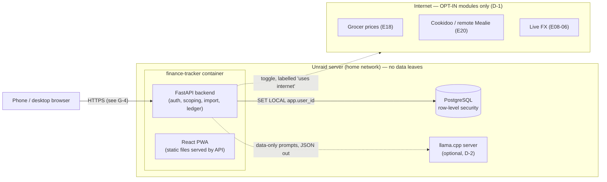

# Architecture (E01-01)

Status: **v0.1, M1 foundation.** Decisions this rests on: D-1 and D-5 (confirmed), P-12 stack (approved).

## Overview

**Offline core:** auth, households, accounts, import, ledger, budgets, stock, analytics and the copilot (when an LLM is configured, with a rules fallback otherwise). All of these run with no internet connection.

**Network modules:** each sits behind a per-household toggle, is off by default, and is labelled "uses internet". If a module fails, the core keeps working.

## Stack (P-12)

| Layer | Choice | Why |
|---|---|---|
| Backend | Python 3.14, FastAPI, SQLAlchemy 2, Alembic | Strong parsing, OCR and LLM ecosystem (OFX, MT940, PDF, Tesseract) |
| DB | PostgreSQL 15+ | Row-level security makes household isolation a database guarantee (§2, §23) |
| Frontend | React + Vite + TypeScript, PWA | Mobile-first shell, offline-capable, installable without an app store |
| Auth | Server-side sessions, Argon2id passwords, HttpOnly cookie | Distinct login per user (§3.4); the session can be revoked immediately |
| Deploy | Docker image (GitHub releases) + Unraid template | §20 |

## Tenant isolation: defence in depth (§2, §3.3, §23)

1. **Database (backstop).** The app connects as `ft_app`, a role that is not a superuser, does not own the tables and cannot bypass row-level security. Every tenant table has `FORCE ROW LEVEL SECURITY` and policies keyed on `current_setting('app.user_id')`, which is set per transaction with `SET LOCAL`. A forgotten `WHERE` clause in app code therefore still cannot leak another household's rows.
2. **API.** Household-scoped routes check membership and role explicitly and return 404 rather than 403, so the existence of other households isn't revealed.
3. **Tests.** Isolation tests create two households and assert that nothing crosses between them.

Before a user is known, a few steps must run outside row-level security: login lookup, session lookup, registration and invite acceptance. These run through narrow `SECURITY DEFINER` functions that return only what that step needs.

### Visibility rules (M1; see gap G-11)

| Data | Visible to |
|---|---|
| User profile | The user, plus display name/email to co-members of a shared household |
| Household, memberships | Members of that household |
| Account | Its owner, plus members of any household it is shared into |
| Transaction / import batch | Anyone who can see the account |
| Attribution (`include`/`hide`) | Household members. It only changes rollups, never access (§3.5) |

## Roles (§3.4, §20)

| Action | owner | admin | member |
|---|---|---|---|
| View household data | ✓ | ✓ | ✓ |
| Share own account into household | ✓ | ✓ | ✓ |
| Create/revoke invites | ✓ | ✓ | — |
| Remove members | ✓ | ✓ (not owner) | — |
| Rename/delete household | ✓ | — | — |

## Ledger rules (§2)

Each account has one master: bank imports. Receipts and manual entries reconcile onto the account (E04, later). Imports are deduplicated with a fingerprint of (account, date, amount, normalised description, occurrence index), so re-importing the same file is a no-op.

## Golden rules as checkable constraints (E01-03)

| Rule | Enforced by |
|---|---|
| Core fully offline | No outbound HTTP in core modules; network modules isolated in `app/modules/online/*` behind toggles |
| Household isolation | Row-level security + API checks + isolation tests |
| Distinct login | Per-user sessions; token stored only as a SHA-256 hash |
| AI is data-only | LLM prompts wrap uploaded content as data and validate JSON output (E05) |
| Mobile-first | Every screen designed for the mobile shell first |
